# shipyard

Shipyard runs a local crew of specialist coding agents against your Git repositories. Choose Claude Code or Codex for each run. The crew builds features, fixes bugs, and checks its work in a separate Git worktree. You review the resulting branch before merging or publishing.

A real run against the demo app (Claude Opus 5.5 on a Pro subscription):

```
shipyard ship demo-shop 'Add a GET /health endpoint that returns {"status": "ok"}'
```

```
run 20261120-160910-add-a-get-health-endpoint-8dcf
  branch   shipyard/20261120-160910-add-a-get-health-endpoint-8dcf
▸ implement · backend · attempt 1/3
    · Bash ls -R src test e2e && cat package.json src/server.js && ls test && head -60 test/*server* 2>/dev/null
    · Bash head -40 e2e/api.e2e.test.js && head -15 test/cart.test.js
    · Edit …/src/server.js
    · Write …/test/health.test.js
    · Bash npm test 2>&1 | tail -15 && npm run e2e 2>&1 | tail -8
    ✓ gate `npm test` (0.9s)
▸ e2e · e2e-tester · attempt 1/1
    · Bash git show HEAD --stat; git show HEAD -- src/; ls e2e; cat package.json; cat e2e/*.js
    · Write …/e2e/health.e2e.test.js
    · Bash npm run e2e 2>&1 | tail -25
    ✓ gate `npm run e2e` (1.0s)
✓ passed · ~$0.29 est. · 74s · 2 attempts
```

The result is two commits on the run's branch: a one-line route plus 5 unit tests (`implement`), then 7 E2E tests (`e2e`), with the tester's commit touching only `e2e/`. `~$0.29` is the SDK's estimate at API prices. On a subscription nothing is billed; it's how much of your plan's usage the run took.

## Choose Claude or Codex

Claude is the default. To use Codex, install the Codex CLI, run `codex login`, and select **Codex** in the web UI or pass `--provider=codex`:

```sh
shipyard ship demo-shop 'Add a /health endpoint' --provider=codex
shipyard fix demo-shop 'The API returns a success status for missing products' --provider=codex
shipyard eval --provider=codex --task bug-product-404
```

Set `defaultProvider: codex` in `shipyard.config.yaml` to use Codex for unspecified runs. The optional `codex` block accepts `model`, `models`, `effort`, and `timeoutMsPerAttempt`. When you omit model and effort, Codex uses its built-in defaults. The attempt timeout defaults to 20 minutes. Top-level model, effort, auth, and budget settings apply to Claude.

Codex uses saved CLI credentials and reports tokens when available. The dollar budget controls and live agent questions and permissions are Claude features. Both providers support stage checkpoints and feedback. Codex agents use a worktree sandbox with network access disabled, so prepare dependencies locally or use Claude when a task needs registry access. Shipyard runs the configured test gates locally using the same process for both providers.

### Launch from Codex chat

From a chat in the Shipyard checkout, invoke `$shipyard` and describe the feature or bug. To use the skill from other repositories, put the skill folder under `~/.agents/skills` and make the CLI available on your PATH with `npm link` from this checkout:

```sh
mkdir -p ~/.agents/skills
ln -s "$(pwd)/.agents/skills/shipyard" ~/.agents/skills/shipyard
npm link
```

Run those commands from the Shipyard checkout. In Codex, use `$shipyard start UI` to open the dashboard or `$shipyard start demo UI` to open it with scripted agents. To start a fleet run, try `$shipyard ship a /health endpoint on demo-shop`. The skill uses the registered targets from `shipyard targets`. For interactive checkpoint approvals, use Shipyard's web UI. Shipyard creates local commits on the run branch for you to review.

## The crew

| Stage | Agent | Job | May edit | Passes when |
|---|---|---|---|---|
| triage *(optional, bug fixes)* | `bug-triager` | Turns the bug report into a minimal failing test. The pipeline checks the tests really **fail** on the current code: no reproduction, no fix | test files only | the tests fail because of the new test |
| plan *(optional)* | `planner` | Studies the repo, asks you about anything ambiguous, writes a spec and task list | nothing (read-only) | it wrote a plan |
| implement | `backend` or `frontend` (or `dependency-updater` for dependency runs) | Builds the change with unit tests; for a bug, makes the triage test pass (or reproduces it first) | anything in the worktree | the unit tests pass |
| review *(optional)* | `reviewer` | Reviews the diff in a fresh session that never saw the author's reasoning: bugs, missed requirements, security, test gaps | nothing (read-only) | no blocker or major findings |
| revise | implementer, resumed | Fixes the reviewer's blocker and major findings (or explains why not) | anything in the worktree | the unit tests pass |
| security *(optional)* | `security-auditor` | Audits the change like an attacker: secrets, injection, input handling, access control, vulnerable dependencies (runs the project's audit tool) | nothing (read-only) | no critical or high findings |
| harden | implementer, resumed | Fixes the critical and high security findings (or explains why not) | anything in the worktree | the unit tests pass |
| e2e *(optional)* | `e2e-tester` | Proves the change through the public interface (HTTP, CLI, UI) | test files only | the E2E tests pass |
| repair *(optional)* | implementer, resumed | Fixes the code when the E2E tests find a defect | anything except E2E tests | unit and E2E tests pass |
| docs *(optional)* | `docs-writer` | Updates the README, changelog and docs to match | documentation only | always (no change is fine) |
| release *(optional)* | `release-manager` | Bumps the version and writes release notes; never publishes, tags or pushes | version files, lockfiles, changelog | the unit tests pass |

There are three kinds of run: **ship** a feature, **fix** a bug, and **update dependencies** (the `dependency-updater` implements: patch and minor versions by default, majors only when you ask, and the rest of the crew checks the result). Pick the crew per run in the UI's **Crew** table (or with `--crew` and `--implementer`). Without a choice, runs use implement + e2e + repair. Each role is a Claude Code subagent file in `plugins/shipyard/agents/`, and the same file drives both the interactive plugin and the scripted pipeline. The reviewer returns its verdict as structured data (enforced by the selected provider), so "approve" and "request changes" are never guessed from prose. The triager's report and the security auditor's verdict work the same way.

## How it works

```mermaid
flowchart LR
  R[request] --> W[git worktree<br/>shipyard/&lt;run-id&gt;]
  W --> T[triage<br/><i>bug-triager</i><br/>tests must FAIL]
  T --> P[plan<br/><i>planner</i><br/>read-only]
  P --> I[implement<br/><i>backend / frontend</i>]
  I --> G1{unit tests}
  G1 -- fail: output fed back<br/>to same session --> I
  G1 -- pass --> RV[review<br/><i>reviewer, fresh</i><br/>read-only]
  RV -- blocker/major findings --> RE[revise<br/><i>implementer, resumed</i>]
  RE --> RV2{unit tests}
  RV2 -- pass --> S
  RV -- approve --> S[security<br/><i>security-auditor</i><br/>read-only]
  S -- critical/high --> H[harden<br/><i>implementer, resumed</i>]
  H --> HV{unit tests}
  HV -- pass --> E
  S -- pass --> E[e2e<br/><i>e2e-tester</i><br/>tests-only lane]
  E --> G2{e2e tests}
  G2 -- fail --> RP[repair<br/><i>implementer, resumed</i><br/>may not edit e2e]
  RP --> G3{unit + e2e}
  G3 -- pass --> DOC
  G2 -- pass --> DOC[docs<br/><i>docs-writer</i>]
  DOC --> REL[release<br/><i>release-manager</i>]
  REL --> D[done: branch ready for review]
```



Optional stages you switch off are simply skipped. Every stage that changes files gets its own commit on the run's branch.

| Piece | Where | What it does |
|---|---|---|
| Roles | `plugins/shipyard/agents/*.md` | One source of truth: Claude Code loads them as subagents, and the pipeline loads them as roles |
| Pipeline | `src/pipeline.ts` | Runs stages, gates, retries, per-stage commits and the cross-agent repair loop |
| Agent runners | `src/agent.ts`, `src/codex.ts` | Run roles through the Claude Agent SDK or Codex CLI |
| Guards | `src/guards.ts`, `plugins/shipyard/hooks/guard-publish.mjs` | Defines write lanes and the Claude tool guard. Codex uses its CLI sandbox and Shipyard checks the resulting diff. |
| Run store | `src/store.ts` | Writes `.shipyard/runs/<id>/run.json` and an `events.jsonl` with every tool call |
| Evals | `evals/`, `src/eval.ts` | Seeded bugs and feature tasks, graded by hidden tests the agents never see |

## Quick start

Requires Node 22+ and Git. For Claude runs, sign in with `claude auth login` and check with `claude auth status`. For Codex runs, install the Codex CLI and sign in with `codex login`.

```bash
npm install
```

```bash
npm test
```

```bash
npm run eval:validate
```

```bash
npm run demo:init
```

```bash
npm run shipyard -- ship demo-shop "Add a GET /health endpoint that returns {\"status\": \"ok\"}"
```

`npm test` and `npm run eval:validate` use no provider usage: the tests use a scripted fake agent, and validation checks the eval tasks without running agents. `fix`, `ship`, and `eval` run real agents and count against the selected provider's usage limits. For Claude, two limits in `shipyard.config.yaml` keep a run in check, both on the SDK's estimated cost at API prices: each agent stops at `maxBudgetUsdPerStage` ($3), and a whole run stops before it goes over `maxBudgetUsdPerRun` ($10). Each agent only gets what is left of the run's budget. Set a different limit for one run in the UI's New run form or with `--budget=`. A run that reaches its limit ends as failed, keeping what earlier stages committed.

### Claude authentication

`auth: subscription` (the default) runs Claude agents on your Claude Code sign-in. Shipyard strips `ANTHROPIC_API_KEY`, `ANTHROPIC_AUTH_TOKEN`, `ANTHROPIC_BASE_URL` and the cloud-provider switches from the agents' environment, so a stray export in your shell can't quietly move runs to per-token billing. The CLI tells you when it ignores one. Set `auth: api-key` if you do want to bill an API account.

If the sign-in has expired, the run stops at once with an `error` and a hint to run `claude auth login`. It never grades untouched code as a pass.

### The web UI (no terminal needed)

```bash
npm run shipyard -- ui
```

It opens a local page (127.0.0.1 only, guarded by a private token) where you can do the following. The token is kept across restarts, so open tabs keep working when you restart the UI. Lost the link? `npm run shipyard -- ui-link` prints it again, and `--new-token` signs every browser out.

- **Start runs** on any configured target and run several at once. Each run gets its own worktree, so runs never collide. For each run you pick:
  - the **provider**, plus its **model** and reasoning **effort**
  - the **crew**: which of the seven agents run, whether `backend` or `frontend` implements, and which agents you want to pause after for review (implement always runs; the planner and reviewer pause cards show the plan and the findings)

  The dialog remembers your last choices in your browser.
- **Watch every agent live** in its own lane: tool calls, notes, gate results, summaries, retries and your decisions, plus the estimated usage, working time and time waiting for you.
- **Answer everything in one inbox**: checkpoint reviews with the diff, multiple-choice **questions agents ask you** (Claude Code's `AskUserQuestion`), and **permission requests** for tools outside a role's allowlist (`askTools` in the config, e.g. web access). Allow them once or for the whole run. Each agent waits only for its own item, so you can answer in any order while the others keep working.
- **Control an active run** from its details. **Stop run** interrupts its agent, test command, or inbox wait and keeps its branch and worktree. **Steer** interrupts the current attempt and continues with your instruction. **Switch to Claude** or **Switch to Codex** continues on the same worktree with a fresh session using that provider's configured defaults. The next attempt runs the usual gates.
- **Archive run** moves an inactive run into the **Archived** view. Open it there to review its history or choose **Restore run**.

`npm run shipyard -- ui --demo` runs the same UI with a scripted crew that builds a real `/health` endpoint on the demo shop, asks a question and requests web access, without calling Claude. Use it to try the UI or show it.

The publish guard and lanes still apply in the UI: a human can't approve a `git push` or an out-of-lane edit from a permission card, because the guard runs before the permission check.

### Steer a run with checkpoints

Add `--checkpoints` and the run pauses after each stage, so you can review it before it moves on:

```bash
npm run shipyard -- ship demo-shop "Add a GET /health endpoint" --checkpoints
```

A checkpoint looks like this (captured from a scripted test run of a small `add()` bug fix; real agents produce the same screen):

```
━━ checkpoint · implement passed its gates (attempt 1) ━━

backend says:
  Root cause: add() used minus. Fixed it and added test/add.test.js.

Changes in this stage:
  M  src/add.js  (+1 -1)
  A  test/add.test.js  (+4, new)

Gates:
  ✓ npm test (0.6s)

To talk to this agent directly: cd ~/.shipyard/worktrees/<run> && claude --resume <session>

[a] approve and continue   [d] full diff   [f] feedback to the agent   [s] stop the run
```

- **approve**: commit the stage and move on.
- **feedback**: your words go into the same agent session, the gates run again, and you get another checkpoint. Feedback can also be multi-line.
- **stop**: end the run as `stopped`, keeping the worktree and its uncommitted work, so you can review or finish the work by hand. For Claude runs you can also reopen the session with `claude --resume`.

When a stage runs out of retries, a checkpoint pauses instead of failing, so you can tell the agent what's actually wrong. After an E2E failure you can also continue, which hands the failure to the implementer for repair as usual. Use `--checkpoints=implement` (or `e2e`, `repair`) to pause only where you care. Every decision is recorded in `run.json`.

### Use it on your own repos

In the UI, click **New run → + Add repo**. It lists the git repos it finds next to shipyard and in your usual project folders (or type any path). It then:
- checks the folder is a git repo with commits, and warns that uncommitted changes won't be included
- detects the test and E2E commands from the repo: `package.json` scripts (with npm, pnpm, yarn or bun), pytest, `make test`, Go and Rust; watch and interactive scripts are skipped, because they'd never exit
- saves the repo to `shipyard.config.yaml`, keeping your comments, so it's available straight away

Or add a target to `shipyard.config.yaml` by hand:

```yaml
targets:
  my-api:
    path: ~/code/my-api
    test: npm test
    e2e: npm run test:e2e
```

Shipyard works from the target's latest commit (`HEAD`) on a new branch in its own worktree, so your checkout and uncommitted changes are never touched. Review the result with `git log` / `git diff` on the `shipyard/<run-id>` branch, then merge it or open a PR yourself.

### Use it interactively in Claude Code

The same roles ship as a Claude Code plugin with `/shipyard:fix-bug` and `/shipyard:ship` commands:

```bash
claude plugin marketplace add ~/Documents/GitHub/shipyard
```

```bash
claude plugin install shipyard@shipyard
```

The plugin's hook blocks `git push`, publishes and PR creation, unless you start the session with `SHIPYARD_ALLOW_PUBLISH=1`.

## Commands

| Command | |
|---|---|
| `shipyard fix <target> "<bug report>"` | Reproduce with a failing unit test, fix, add E2E coverage |
| `shipyard ship <target> "<feature request>"` | Implement with unit tests, verify end to end |
| `shipyard deps <target> ["<notes>"]` | Update dependencies safely and verify (notes optional, e.g. "majors too") |
| `--checkpoints[=stages]` on `fix` / `ship` | Pause after stages to approve, give feedback or stop |
| `--provider=claude\|codex` on `fix` / `ship` / `deps` / `eval` | Provider for every stage in the run |
| `--budget=10` on `fix` / `ship` / `deps` | Estimated dollar limit for a Claude run (default `maxBudgetUsdPerRun`) |
| `--crew=triage,plan,review,security,e2e,repair,docs,release` on `fix` / `ship` / `deps` | The optional agents that run (default `e2e,repair`; implement always runs; triage is for bug fixes, plan isn't used for dependency runs) |
| `--implementer=frontend` on `fix` / `ship` | Who implements, revises and repairs: `backend` (default) or `frontend` |
| `--model=… --effort=…` on `fix` / `ship` | Model and effort for every agent in this run |
| `shipyard ui [--demo] [--port 4710] [--no-open] [--new-token]` | The web UI: start runs, watch agents, answer the inbox |
| `shipyard ui-link` | Print the running UI's link again |
| `shipyard eval [--task <id>]...` | Run the eval suite and print solve rate, cost per solved task and time |
| `shipyard eval --validate` | Check every eval task is fair (no agents, free) |
| `shipyard runs` | List recent runs |
| `shipyard roles` | List agent roles |
| `shipyard targets` | List configured target repositories |

Run them with `npm run shipyard -- <command>`, or `npm link` once to get a global `shipyard` command.

## Evals

Seven tasks against `examples/demo-shop` (five seeded bugs, two features). Each task gets a fresh copy of the app as a single-commit repo, so `git log` gives nothing away. The agents get a user-style report that describes symptoms, not files. After the pipeline finishes, a hidden test grades the branch.

`--validate` makes sure each task is a fair test: a bug's hidden test must pass on the correct app and fail on the seeded one, and a feature's hidden test must fail on the current app and pass with a reference solution.

Results go to `evals/results/<timestamp>.json`.

## Design decisions

- **The pipeline runs the gates, not the agent.** An agent saying "tests pass" counts for nothing. The pipeline runs the command in the worktree, and on failure feeds the output back to the same session, which keeps its context and is cheaper than starting over.
- **Lanes are enforced, not requested.** The E2E tester can only write test files, and during repair the implementer cannot edit E2E tests, so neither can make a failing test pass by editing the other's work. Claude uses a PreToolUse hook for direct file edits. Shipyard checks the resulting diff for both providers and restores files outside the stage lane before running gates.
- **One worktree per run, outside this repo.** Parallel runs can't collide, the target checkout stays clean, and this repo's own CLAUDE.md never leaks into a target session. Only the target's project settings load (`settingSources: ["project"]`), so runs are reproducible across machines.
- **Humans steer at stage boundaries, inside the agent's own session.** A checkpoint never edits the agent's history or starts a fresh agent. Feedback is a new message in the same session, so the agent keeps everything it learned, and the gates still decide whether the result passes. A human can't approve a failing stage.
- **One inbox, one pending answer per item.** Every checkpoint, question and permission request is its own promise in the run manager. Answering one resolves only that agent, which is what lets several agents across several runs wait on you at the same time.
- **The UI is local and locked down.** It binds to 127.0.0.1, needs the token from the printed link (then a `SameSite=Strict`, `HttpOnly` cookie), rejects other `Host` headers (DNS rebinding) and cross-origin writes, sends a strict CSP, and renders all agent text as text, never HTML. It has no build step and no dependencies.
- **Subagents and a deterministic pipeline, not an agent swarm.** The order of stages is fixed code, so a run can be tested with a fake agent, replayed and measured. Claude Code's agent teams are still experimental; they would make sense as an optional mode for open-ended work, not as the default path.
- **An agent error is never a result.** If an agent can't run (sign-in, API error, crash), the run ends as `error` without grading, and a stage that leaves the tree unchanged fails even with green tests. This was caught by a real run: an expired sign-in once produced a "pass" on untouched code. There's now a regression test for it.
- **Nothing leaves the machine without a human.** Push, publish, PR and deploy commands are blocked for every agent. The pipeline ends with a branch for you to review.
- **Evals before more agents.** Adding roles is easy. Knowing whether they help needs a solve rate and a cost per solved task on tasks the agents can't see.

## Roadmap

- [ ] `shipyard new <name> "<app idea>"`: create a new app repo from a starter template, then hand it to the crew
- [x] Planner, reviewer (structured verdict + revise loop), frontend, docs and release roles
- [ ] Playwright-based E2E and a frontend demo target
- [x] bug-triager (a failing reproduction before any fix), security-auditor (structured verdict + harden loop), dependency-updater (its own kind of run)
- [ ] More crew: accessibility auditor, performance checker
- [x] Local web UI: live agent lanes, parallel runs, one inbox for checkpoints, questions and permissions
- [ ] Stop an agent mid-turn from the UI (today you stop at the next checkpoint or with Ctrl-C)
- [ ] BE and FE agents working on one run in parallel, once a planner splits the work
