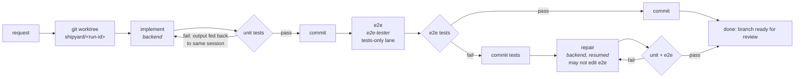

# shipyard

Clone it once, and you have a crew of specialist Claude Code agents on your own machine, running on your Claude subscription. Point it at any of your repos and the crew builds features and fixes bugs there, each agent in its own role: one implements, one proves it works end to end, and more roles (docs, release, frontend, review) are on the way. Nothing leaves your computer without you.

A real run against the demo app (Claude Opus 5.5 on a Pro subscription):

```
shipyard ship demo-shop 'Add a GET /health endpoint that returns {"status": "ok"}'
```

```
run 20261120-160910-add-a-get-health-endpoint-8dcf
  branch   shipyard/20261120-160910-add-a-get-health-endpoint-8dcf
▸ implement · backend · attempt 1/3
    · Bash ls -R src test e2e && cat package.json src/server.js && ls test && head -60 test/*server* 2>/dev/null
    · Bash head -40 e2e/api.e2e.test.js && head -15 test/cart.test.js
    · Edit …/src/server.js
    · Write …/test/health.test.js
    · Bash npm test 2>&1 | tail -15 && npm run e2e 2>&1 | tail -8
    ✓ gate `npm test` (0.9s)
▸ e2e · e2e-tester · attempt 1/1
    · Bash git show HEAD --stat; git show HEAD -- src/; ls e2e; cat package.json; cat e2e/*.js
    · Write …/e2e/health.e2e.test.js
    · Bash npm run e2e 2>&1 | tail -25
    ✓ gate `npm run e2e` (1.0s)
✓ passed · ~$0.29 est. · 74s · 2 attempts
```

The result is two commits on the run's branch: a one-line route plus 5 unit tests (`implement`), then 7 E2E tests (`e2e`), with the tester's commit touching only `e2e/`. `~$0.29` is the SDK's estimate at API prices. On a subscription nothing is billed; it's how much of your plan's usage the run took.

## The crew

| Role | Status | Job | May edit |
|---|---|---|---|
| `backend` | ready | Implements features; for bugs, reproduces with a failing test first, then fixes | anything in the worktree (not E2E tests during repair) |
| `e2e-tester` | ready | Proves the change through the public interface (HTTP, CLI, UI) | test files only |
| `planner` | planned | Turns a request into a spec and task list before anyone codes | `docs/` |
| `frontend` | planned | UI changes, with Playwright checks | UI code |
| `reviewer` | planned | Reviews the branch in a fresh context that never saw the author's session | nothing (comments only) |
| `docs` | planned | Updates README, changelog and API docs to match the change | docs |
| `release` | planned | Versions, tags and publishes, only after you approve | release files |

Each role is a Claude Code subagent file in `plugins/shipyard/agents/`. The same file drives the interactive plugin and the scripted pipeline.

## How it works



| Piece | Where | What it does |
|---|---|---|
| Roles | `plugins/shipyard/agents/*.md` | One source of truth: Claude Code loads them as subagents, and the pipeline loads them as roles |
| Pipeline | `src/pipeline.ts` | Runs stages, gates, retries, per-stage commits and the cross-agent repair loop |
| Agent runner | `src/agent.ts` | Runs a role headless through the Claude Agent SDK, with a budget and turn cap |
| Guards | `src/guards.ts`, `plugins/shipyard/hooks/guard-publish.mjs` | Checks every tool call: blocks pushes and publishes, writes outside the worktree, and edits outside the role's lane |
| Run store | `src/store.ts` | Writes `.shipyard/runs/<id>/run.json` and an `events.jsonl` with every tool call |
| Evals | `evals/`, `src/eval.ts` | Seeded bugs and feature tasks, graded by hidden tests the agents never see |

## Quick start

Requires Node 22+, git, and Claude Code signed in to your Claude subscription (`claude auth login`, check with `claude auth status`). The agents run on that sign-in through the Claude Agent SDK.

```bash
npm install
```

```bash
npm test
```

```bash
npm run eval:validate
```

```bash
npm run demo:init
```

```bash
npm run shipyard -- ship demo-shop "Add a GET /health endpoint that returns {\"status\": \"ok\"}"
```

`npm test` and `npm run eval:validate` use no Claude usage: the tests use a scripted fake agent, and validation checks the eval tasks without running agents. `fix`, `ship` and `eval` run real agents and count against your subscription's usage limits. Each stage stops at `maxBudgetUsdPerStage` of estimated cost in `shipyard.config.yaml`.

### Subscription, not API billing

`auth: subscription` (the default) runs every agent on your Claude Code sign-in. Shipyard strips `ANTHROPIC_API_KEY`, `ANTHROPIC_AUTH_TOKEN`, `ANTHROPIC_BASE_URL` and the cloud-provider switches from the agents' environment, so a stray export in your shell can't quietly move runs to per-token billing. The CLI tells you when it ignores one. Set `auth: api-key` if you do want to bill an API account.

If the sign-in has expired, the run stops at once with an `error` and a hint to run `claude auth login`. It never grades untouched code as a pass.

### Use it on your own repos

Add a target to `shipyard.config.yaml`:

```yaml
targets:
  my-api:
    path: ~/code/my-api
    test: npm test
    e2e: npm run test:e2e
```

Shipyard works from the target's latest commit (`HEAD`) on a new branch in its own worktree, so your checkout and uncommitted changes are never touched. Review the result with `git log` / `git diff` on the `shipyard/<run-id>` branch, then merge it or open a PR yourself.

### Use it interactively in Claude Code

The same roles ship as a Claude Code plugin with `/shipyard:fix-bug` and `/shipyard:ship` commands:

```bash
claude plugin marketplace add ~/Documents/GitHub/shipyard
```

```bash
claude plugin install shipyard@shipyard
```

The plugin's hook blocks `git push`, publishes and PR creation, unless you start the session with `SHIPYARD_ALLOW_PUBLISH=1`.

## Commands

| Command | |
|---|---|
| `shipyard fix <target> "<bug report>"` | Reproduce with a failing unit test, fix, add E2E coverage |
| `shipyard ship <target> "<feature request>"` | Implement with unit tests, verify end to end |
| `shipyard eval [--task <id>]...` | Run the eval suite and print solve rate, cost per solved task and time |
| `shipyard eval --validate` | Check every eval task is fair (no agents, free) |
| `shipyard runs` | List recent runs |
| `shipyard roles` | List agent roles |

Run them with `npm run shipyard -- <command>`, or `npm link` once to get a global `shipyard` command.

## Evals

Seven tasks against `examples/demo-shop` (five seeded bugs, two features). Each task gets a fresh copy of the app as a single-commit repo, so `git log` gives nothing away. The agents get a user-style report that describes symptoms, not files. After the pipeline finishes, a hidden test grades the branch.

`--validate` makes sure each task is a fair test: a bug's hidden test must pass on the correct app and fail on the seeded one, and a feature's hidden test must fail on the current app and pass with a reference solution.

Results go to `evals/results/<timestamp>.json`.

## Design decisions

- **The pipeline runs the gates, not the agent.** An agent saying "tests pass" counts for nothing. The pipeline runs the command in the worktree, and on failure feeds the output back to the same session, which keeps its context and is cheaper than starting over.
- **Lanes are enforced, not requested.** The E2E tester can only write test files, and during repair the implementer cannot edit E2E tests, so neither can make a failing test pass by editing the other's work. A PreToolUse hook blocks out-of-lane edits, and a check after each stage reverts any that got through via the shell.
- **One worktree per run, outside this repo.** Parallel runs can't collide, the target checkout stays clean, and this repo's own CLAUDE.md never leaks into a target session. Only the target's project settings load (`settingSources: ["project"]`), so runs are reproducible across machines.
- **Subagents and a deterministic pipeline, not an agent swarm.** The order of stages is fixed code, so a run can be tested with a fake agent, replayed and measured. Claude Code's agent teams are still experimental; they would make sense as an optional mode for open-ended work, not as the default path.
- **An agent error is never a result.** If an agent can't run (sign-in, API error, crash), the run ends as `error` without grading, and a stage that leaves the tree unchanged fails even with green tests. This was caught by a real run: an expired sign-in once produced a "pass" on untouched code. There's now a regression test for it.
- **Nothing leaves the machine without a human.** Push, publish, PR and deploy commands are blocked for every agent. The pipeline ends with a branch for you to review.
- **Evals before more agents.** Adding roles is easy. Knowing whether they help needs a solve rate and a cost per solved task on tasks the agents can't see.

## Roadmap

- [ ] `shipyard new <name> "<app idea>"`: create a new app repo from a starter template, then hand it to the crew
- [ ] Planner role for features (spec and task breakdown before implementing)
- [ ] Frontend role with Playwright E2E, and a frontend demo target
- [ ] Reviewer role with a fresh context that never sees the author's session
- [ ] Docs and release roles (release blocked behind explicit approval)
- [ ] Local dashboard for runs: stage timeline, diffs, gate output, cost
- [ ] Run several tasks in parallel, one worktree each
