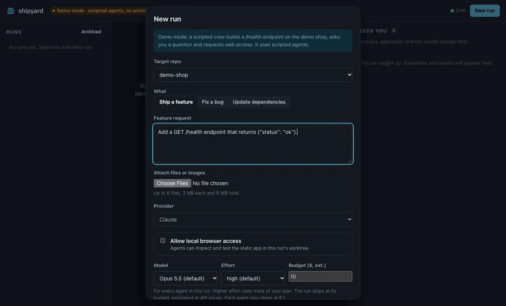
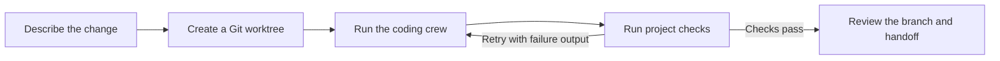

# Shipyard

**Take a feature request from AI-assisted implementation to a tested Git branch you can review.**

Shipyard runs a local crew of Claude Code or Codex agents against your existing repositories. It gives each run a Git worktree, coordinates specialist roles, and runs your project’s checks before handing back the branch and its verification record.

[Quick start](#quick-start) · [How it works](#how-it-works) · [Publish from the dashboard](#publish-from-the-dashboard) · [How AI accelerates development](#how-ai-accelerates-development) · [Re-record the demo](#test-and-record-the-demo) · [Technical reference](docs/reference.md)

## Watch a run



The scripted crew adds `GET /health` to the bundled demo shop. Watch it ask about the response, pause for approval, address a reviewer finding, and hand back a local branch with passing unit and end-to-end checks. The demo uses real Git operations and test commands, with scripted agent responses and zero model calls.

## Why Shipyard

| What you need | What Shipyard gives you |
| --- | --- |
| **Keep your workspace free for other work** | Each run starts from committed Git history in its own worktree. Your current checkout stays available while the crew works. |
| **See why a change is ready** | The dashboard brings together diffs, agent activity, checkpoint decisions, and the results of your repository’s test commands. |
| **Stay involved when it matters** | Approve checkpoints, give feedback on the same branch, or stop and resume. You can switch providers in the same worktree with a fresh agent session. |
| **Recover after a failed check** | When an implementation specialist exhausts its retries on a revision’s project check, Shipyard tries one full-stack repair and reruns the checks in the same worktree. If the repair needs another attempt, use **Retry repair**. **Check saved edits** runs the checks without committing, and **Continue this run** saves verified edits and resumes the run. |
| **Recover a Git-only revision** | **Review branch cleanup** previews the commits and asks for a branch name. After you approve, Shipyard runs the configured checks and creates a squashed branch with the original available as a backup. |

## Quick start

Requires Node.js 22+ and Git. To open the local dashboard with the sample shop and scripted crew, run the following from the checkout.

```sh
npm ci
npm run shipyard -- ui --demo
```

Choose **New run** and enter `Add a GET /health endpoint that returns {"status": "ok"}.` Answer the planner and approve its plan, then review the implementation and revision checkpoints. You can deny the optional web request and still finish the run.

For live agent runs, sign in with `claude auth login` or `codex login`, then run `npm run shipyard -- ui`. Under **New run → Add repo**, choose a local Git checkout or clone a Git URL, and review the detected test commands. Live runs use your selected provider account. [Provider settings and usage](docs/reference.md#providers-and-usage)

You can also launch from a coding chat with the [Codex skill](docs/reference.md#codex-skill) or the [Claude Code plugin](docs/reference.md#claude-code-plugin).

## How it works



The TypeScript pipeline controls stage order, retries, and checkpoints. Provider adapters run the agent sessions. Role-specific edit scopes constrain specialists, and review or E2E findings can go back to the implementer for another pass. The handoff records the branch, changed files, checks, and pending work. [Crew and stage order](docs/reference.md#crew-and-stage-order) · [Dashboard controls](docs/reference.md#dashboard-controls)

## Publish from the dashboard

- **GitHub draft PRs.** Sign in with `gh auth login`. In a completed run’s handoff, choose **Create draft PR** to review the destination and edit a description based on the changes and checks. Approve the push and draft together. For unrelated histories, review how Shipyard will apply the run’s changes to GitHub’s current default branch and verify the result. Shipyard links an existing open PR when available. [GitHub handoff controls](docs/reference.md#dashboard-controls)
- **Cloud Run releases.** Add **Google Cloud release** to the crew to get a read-only release plan. In the handoff, choose **Review Cloud Run release** and supply an existing single-container service and an Artifact Registry image pinned to a digest. Review the signed-in Google Cloud account, destination, and permissions before approving a new revision with zero traffic. [Cloud Run prerequisites and permissions](docs/reference.md#google-cloud-releases)

## How AI accelerates development

**In Shipyard runs**, a planner can turn a short request into an implementation plan, an implementer can write code and tests, and separate reviewer and E2E roles can find problems before handoff. Shipyard passes the plan, findings, and failed test output between stages so you don’t have to relay context between chats. You can review the diff and the actual test results before deciding what to merge.

**In this repository**, Codex helped turn the portfolio walkthrough into a reusable Playwright test. The same browser scenario checks the inbox, checkpoints, and final Git handoff and produces the README recording. Future changes to that flow can be checked and recorded again with the same commands.

## Test and record the demo

The Playwright harness starts Shipyard on a temporary loopback port with a fresh copy of the sample repository. It uses disposable run history and worktrees, and requires no provider credentials or Docker. GIF export requires FFmpeg on your `PATH`.

```sh
npm ci
npx playwright install chromium
npm run test:e2e
npm run demo:record
```

On Linux, use `npx playwright install --with-deps chromium` if browser system dependencies are missing. The recording command saves a raw WebM under `.shipyard/playwright/record-*/` and refreshes `docs/images/shipyard-demo.gif` after the test passes. On a test failure, look for the Playwright trace and screenshot under `.shipyard/playwright/`. [Playwright video recording](https://playwright.dev/docs/videos)

## Development

```sh
npm test
npm run typecheck
npm run eval:validate
```

See the [technical reference](docs/reference.md) for CLI commands, provider differences, and the evaluation suite.

[MIT License](LICENSE)
